<a href="https://azevedothamirest.github.io">
  
</a>

<p align="center">
  <a href="https://azevedothamirest.github.io"></a>
  <a href="https://www.linkedin.com/in/qathamiresazevedo"></a>
  <br>
  <a href="https://www.instagram.com/qa.thami/"></a>
  <a href="mailto:azevedothamirest@gmail.com"></a>
</p>

###  Oi, eu sou a Thamires

Aprendi QA sozinha, testando, errando e anotando tudo. Sete anos depois, sigo com a mesma curiosidade do começo: entender como as coisas funcionam e onde elas podem quebrar.

Gosto de qualidade que começa cedo, na conversa sobre o que vai ser construído, e não só quando a tarefa chega em teste. No dia a dia isso vira **testes manuais e automatizados** lado a lado, cenários em **BDD** e muita conversa com quem constrói e com quem usa.

A outra metade é dividir o que aprendo: o **[@qa.thami](https://www.instagram.com/qa.thami/)** virou uma comunidade de **+15 mil pessoas**, um e-book e palestras. E a **IA** entrou na rotina como parceira para estudar, testar e criar ferramentas, sempre com olhar crítico.

```yaml
agora: ▒▒▒▒▒▒▒▒ (carregando…)
ensinando: QA para +15 mil no @qa.thami
aberta_a: palestras, eventos e parcerias de conteúdo
inglês: B2, rumo ao C1
```

---

###  Ensino e comunidade · [@qa.thami](https://www.instagram.com/qa.thami/)

Ensino QA para quem está começando, do jeito que eu queria ter aprendido: **+15 mil seguidores** no Instagram, um e-book e palestras.

- **2021** · Seminário *Iniciante em Testes: o que você precisa saber!*
- **2022**
  - E-book [*Comece por aqui, QA!*](https://www.amazon.com.br/dp/B0B2B64DGH)
  - Participação no QAVerso
- **2023**
  - TDC Connections · *Quality Assurance: o atraso do Brasil e a necessidade de mudanças na visão empresarial*
  - GDG DevFest Maceió (Roga DX)
- **2024** · TDC Summit Recife · *Como a Inteligência Artificial Está Redefinindo os Testes de Software*

---

###  O que eu construo

Quando uma dor se repete no dia a dia, vira ferramenta. O QA Scout é a primeira que abri para todo mundo: gratuita, de código aberto e feita para quem testa.

<table>
  <tr>
    <td colspan="2" valign="top">
      <h4> <a href="https://github.com/azevedothamirest/qa-scout">QA Scout</a>  </h4>
      <p>Extensão do Chrome para teste exploratório (SBTM): organiza a sessão, captura cliques e erros sozinha e entrega o relatório pronto. Tem servidor MCP em que o Claude conduz a sessão, e 4 idiomas.</p>
      <sub><code>Playwright</code> <code>JavaScript</code> <code>GitHub Actions</code> <code>Chrome Extension</code> <code>MCP</code> · <a href="https://chromewebstore.google.com/detail/qa-scout/goffncpkhonlejcokjgiobomlpiefpin">Chrome Web Store</a> · <a href="https://azevedothamirest.github.io/qa-scout/">abrir o app</a></sub>
    </td>
  </tr>
</table>

---

###  Trajetória

Passei por **consultoria** (Accenture) e **fintech** (Grafeno) antes de ▒▒▒▒▒▒▒▒ <sub><i>carregando…</i></sub>


---

<p align="center">
  <sub>Gostou? Veja o <a href="https://azevedothamirest.github.io">portfólio completo</a> ou <a href="mailto:azevedothamirest@gmail.com">me mande um e-mail</a>.</sub>
</p>
